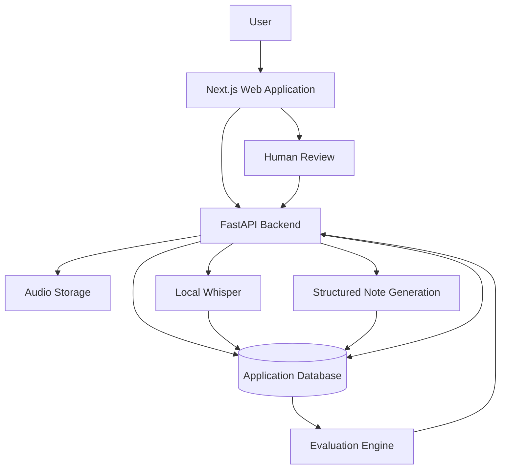

```markdown
# ClearNote AI

**Privacy-conscious conversation intelligence for turning recorded conversations into structured, reviewable knowledge.**

ClearNote AI transforms audio recordings into searchable transcripts and structured notes while keeping transcription local by default. The system preserves the relationship between the original recording, machine-generated transcript, AI-generated notes, and human-reviewed corrections so outputs remain traceable and auditable.

The application is designed around a simple principle:

> AI-generated information should be useful, reviewable, and measurable — not treated as automatically correct.

---

## Overview

ClearNote AI provides an end-to-end workflow for processing recorded conversations:

```text
Audio Recording
      ↓
Local Whisper Transcription
      ↓
Persisted Transcript
      ↓
Structured Note Generation
      ↓
Human Review
      ↓
Evaluation
```

Users can upload recordings, transcribe them locally, generate structured notes, review and correct AI-generated content, reopen historical recordings, and evaluate generated decisions against human-reviewed references.

The architecture deliberately separates transcription, note generation, review, persistence, and evaluation so each component can evolve independently.

---

## Key Capabilities

### Local Audio Transcription

Audio is transcribed using OpenAI Whisper running locally rather than sending the recording to an external transcription service.

This provides a stronger privacy boundary for raw audio and gives the application control over the transcription runtime and model configuration.

Supported functionality includes:

- Audio upload and validation
- Local file persistence
- Local Whisper inference
- Transcript persistence
- Segment-level transcription data
- Duplicate transcription protection
- Configurable Whisper model and execution device

### Structured AI Notes

ClearNote converts transcripts into structured information including:

- Summary
- Decisions
- Action items
- Owners
- Due dates
- Key points
- Follow-up questions

Generated notes are persisted together with metadata describing how they were produced, including the model name and prompt version.

This creates an explicit lineage between:

```text
Recording
   ↓
Transcript
   ↓
Generated Note
```

Prompt version tracking makes it possible to understand how changes to prompting affect downstream outputs.

### Human Review Workflow

AI-generated notes are preserved as the original machine-generated output.

Human corrections are stored separately as a reviewed version rather than overwriting the original result.

```text
Generated Note
      ↓
Human Review
      ↓
Reviewed Note
```

This design preserves both:

```text
What the AI originally produced
```

and:

```text
What the human ultimately approved
```

Maintaining both versions enables auditing, debugging, model evaluation, and future prompt/model comparisons.

Reviewed notes can be created, edited, persisted, and restored after reopening a recording.

### AI Evaluation

ClearNote includes an evaluation layer for measuring generated output against human-reviewed reference data.

The first evaluator focuses on extracted decisions and calculates:

- True positives
- False positives
- False negatives
- Precision
- Recall
- F1 score

The evaluation pipeline follows:

```text
Generated Note
      +
Reviewed Note
      ↓
Decision Evaluator
      ↓
Precision / Recall / F1
```

Human-reviewed notes therefore serve not only as corrected output for users, but also as potential reference data for measuring system quality.

The current evaluator uses normalized text matching. The evaluation architecture is intentionally isolated so more advanced matching strategies can be introduced independently, including semantic similarity and model-assisted evaluation.

---

## Data Lineage

A central design goal of ClearNote is maintaining traceability across the processing lifecycle.

```text
Recording
    │
    ▼
Transcript
    │
    ▼
GeneratedNote
    │
    ▼
ReviewedNote
```

Each layer represents a different type of information:

| Entity | Responsibility |
| --- | --- |
| `Recording` | Original uploaded audio and processing state |
| `Transcript` | Speech-to-text representation of the recording |
| `GeneratedNote` | Original machine-generated structured output |
| `ReviewedNote` | Human-reviewed version of the generated output |

This separation prevents human corrections from destroying the original AI output and provides the foundation for reproducible evaluation.

---

## Architecture



The backend separates responsibilities across API routes, persistence models, validation schemas, domain services, AI processing, and evaluation logic.

This allows infrastructure components to evolve without coupling the entire application to a particular model provider, database, or storage implementation.

---

## Technology Stack

### Backend

- Python 3.11
- FastAPI
- SQLAlchemy 2
- Async database access
- SQLite for local development
- Alembic migrations
- Pydantic
- OpenAI Whisper
- FFmpeg
- OpenAI SDK
- Pytest

### Frontend

- Next.js
- React
- TypeScript
- Tailwind CSS

### AI

- Local Whisper speech recognition
- Structured LLM output
- Versioned prompting
- Human-reviewed reference data
- Precision / recall / F1 evaluation
- Configurable mock AI mode for deterministic local development

---

## AI Provider Modes

ClearNote supports two note-generation modes.

### Provider-backed generation

When configured with an API provider, the transcript is sent to the configured language model and converted into validated structured note data.

### Mock generation

For local development, testing, and deterministic workflows, ClearNote can run with:

```env
MOCK_AI=true
```

Mock mode avoids external API calls while exercising the same application pipeline:

```text
Transcript
   ↓
Note Generation Interface
   ↓
Structured GeneratedNote
   ↓
Human Review
   ↓
Evaluation
```

This allows persistence, review, API behavior, and evaluation infrastructure to be developed and tested independently of model cost or network availability.

---

## Prompt Versioning

Generated notes record the prompt version used during generation.

For example:

```text
model_name = gpt-5-mini
prompt_version = v1
```

Prompt versions are treated as part of the provenance of an AI result because changing a prompt can change accuracy, completeness, formatting, and extraction behavior even when the model and transcript remain unchanged.

Preserving prompt metadata enables future comparisons such as:

```text
Prompt v1 + Model A
        vs
Prompt v2 + Model A
        vs
Prompt v2 + Model B
```

without losing the history of how existing outputs were produced.

---

## Evaluation Design

ClearNote treats AI quality as something that should be measured rather than assumed.

For decision extraction, generated decisions are compared with human-reviewed decisions.

For example:

```text
AI prediction:
["Deploy Monday", "Notify legal"]

Human reference:
["Deploy Monday", "Notify customers"]
```

The evaluator identifies:

```text
True Positive:
Deploy Monday

False Positive:
Notify legal

False Negative:
Notify customers
```

which produces:

```text
Precision = TP / (TP + FP)
Recall    = TP / (TP + FN)
F1        = harmonic mean of precision and recall
```

The evaluation system is being designed to evolve from deterministic matching toward richer evaluation strategies while preserving evaluator versioning and reproducibility.

---

## API

The backend exposes REST endpoints for the recording lifecycle.

| Method | Endpoint | Purpose |
| --- | --- | --- |
| `GET` | `/health` | API health check |
| `POST` | `/api/recordings` | Upload a recording |
| `GET` | `/api/recordings` | List recordings |
| `GET` | `/api/recordings/{recording_id}` | Retrieve a recording |
| `DELETE` | `/api/recordings/{recording_id}` | Delete a recording |
| `POST` | `/api/recordings/{recording_id}/transcribe` | Run transcription |
| `GET` | `/api/recordings/{recording_id}/transcript` | Retrieve transcript |
| `POST` | `/api/recordings/{recording_id}/generate-notes` | Generate structured notes |
| `GET` | `/api/recordings/{recording_id}/notes` | Retrieve generated notes |
| `GET` | `/api/recordings/{recording_id}/reviewed-notes` | Retrieve reviewed notes |
| `PUT` | `/api/recordings/{recording_id}/reviewed-notes` | Create or update human review |
| `GET` | `/api/recordings/{recording_id}/evaluation` | Evaluate generated decisions |

Interactive API documentation is available while the backend is running at:

```text
http://localhost:8000/docs
```

---

## Repository Structure

```text
clearnote-ai/
├── backend/
│   ├── app/
│   │   ├── api/
│   │   │   └── routes/
│   │   ├── core/
│   │   ├── evaluation/
│   │   ├── models/
│   │   ├── schemas/
│   │   └── services/
│   ├── migrations/
│   └── tests/
│
├── frontend/
│   └── src/
│       ├── app/
│       ├── components/
│       ├── lib/
│       └── types/
│
└── README.md
```

---

## Running Locally

### Backend

From the repository root:

```bash
cd backend

python3.11 -m venv .venv
source .venv/bin/activate

pip install -r requirements.txt
```

Apply database migrations:

```bash
python -m alembic upgrade head
```

Start the API:

```bash
python -m fastapi dev app/main.py
```

The API will be available at:

```text
http://localhost:8000
```

### Frontend

In another terminal:

```bash
cd frontend
npm install
npm run dev
```

The application will be available at:

```text
http://localhost:3000
```

Configure the frontend API URL with:

```env
NEXT_PUBLIC_API_BASE_URL=http://localhost:8000
```

---

## Testing

Backend tests can be run from the `backend` directory:

```bash
source .venv/bin/activate
python -m pytest -v
```

The test suite covers application behavior including:

- Recording lifecycle
- Input validation
- Transcript persistence
- Note-generation behavior
- Duplicate-processing protection
- Human review creation and updates
- Review persistence
- Decision evaluation
- Precision, recall, and F1 calculations
- Missing-resource and workflow-state handling

External AI behavior can be replaced with deterministic mock generation so automated tests remain reproducible and do not depend on external APIs.

---

## Privacy and Security

ClearNote is designed with privacy-conscious processing boundaries.

Raw audio transcription is performed locally using Whisper rather than being sent to a third-party transcription API.

Production deployment of sensitive workloads would additionally require controls including authentication, authorization, encryption, secure object storage, secrets management, audit logging, tenant isolation, retention policies, deletion workflows, infrastructure monitoring, and applicable regulatory safeguards.

Secrets, local databases, uploaded recordings, and sensitive transcripts should never be committed to source control.

---

## Engineering Direction

ClearNote's architecture is designed to support a progression from the current single-node application toward a production deployment without changing the fundamental domain model.

Areas of continued development include:

- Semantic and model-assisted AI evaluation
- Versioned evaluation runs and datasets
- Prompt and model comparison
- Quality regression detection
- Background processing for long-running AI workloads
- PostgreSQL persistence
- Object storage for recordings
- Authentication and tenant isolation
- Structured observability and tracing
- Export workflows
- Deployment automation
- Data retention and lifecycle controls

The objective is to maintain clear boundaries between AI inference, deterministic application logic, human judgment, and evaluation as the system evolves.

---

## License

Copyright (c) 2026 Vijay Karingula.

All rights reserved.

This repository is publicly viewable for demonstration purposes. No permission is granted to copy, modify, distribute, sublicense, sell, or otherwise use the software or source code without prior written permission from the copyright holder.
```